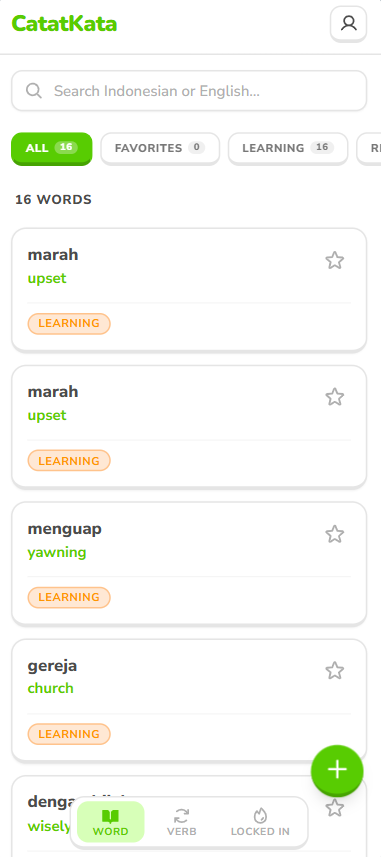
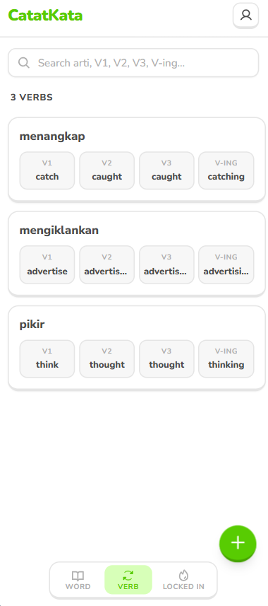
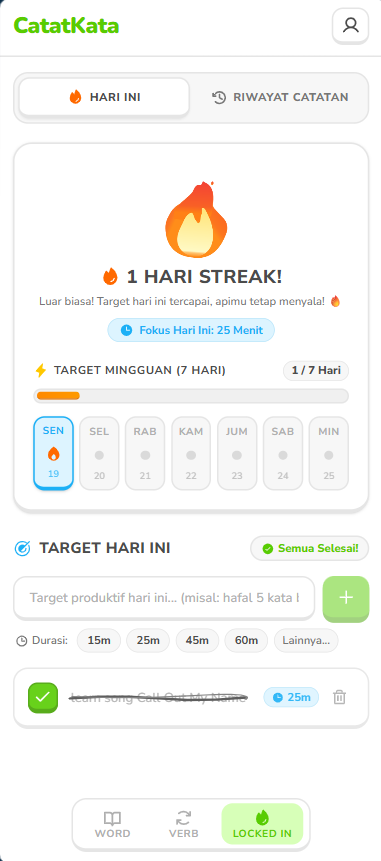

# 📖 CatatKata — Digital Vocabulary Notebook

> **Tinggalkan buku tulis manual yang mudah hilang dan berantakan.**  
> CatatKata hadir sebagai **buku catatan kosakata digital** yang praktis, cepat, dan menyenangkan untuk menemani perjalananmu belajar Bahasa Inggris setiap hari!

Terinspirasi dari gaya visual ceria dan tombol 3D interaktif ala **[Duolingo](https://www.duolingo.com/)**, CatatKata membuat aktivitas mencatat dan mengulang kosakata terasa ringan, memuaskan, dan tidak membosankan.

---

## ✨ Mengapa Memilih CatatKata?

* 📓 **Pengganti Buku Manual Modern** — Semua kosakata baru yang kamu temukan dari buku, artikel, video YouTube, lirik lagu, hingga materi tes tersimpan rapi dalam satu genggaman.
* 📱 **Nyaman di Ponsel (Mobile-First)** — Desain responsif yang dirancang khusus untuk kenyamanan mencatat kilat di perangkat mobile maupun laptop.
* 🎨 **Visual Playful & Memuaskan** — Tombol 3D empuk, animasi coretan pensil saat target selesai, hingga kobaran api streak yang membuatmu selalu terdorong untuk konsisten.
* ⚡ **Pencarian Kilat** — Lupa arti atau bentuk lampau suatu kata? Cukup ketik dan temukan catatanmu dalam sekejap tanpa repot membolak-balik halaman buku.

---

## 🚀 Fitur Unggulan CatatKata

| 📖 1. Kosakata (Word) | 🔄 2. Kata Kerja (Verb) | 🔥 3. Produktivitas (Locked In) |
| :---: | :---: | :---: |
|  |  |  |
| **Kelola Kosakata Harian** • Pasangan kata Indo ↔ Inggris • Jenis kata (*Noun, Verb, Adj*, dll) • Bintang favorit & contoh kalimat • Status: *Learning, Reviewing, Mastered* | **Ensiklopedia Tenses** • Bentuk lengkap **V1, V2, V3, V-ing** • Dilengkapi arti bahasa Indonesia • Desain kartu rapi & mudah dibaca • Pencarian cepat instan | **Fokus Belajar & Api Streak** • Api membara saat selesaikan $\ge 1$ target • Animasi coretan pensil yang memuaskan • Catat durasi waktu fokus harian • Progres 7 hari & riwayat catatan lengkap |

---

## 🎯 Siapa yang Cocok Menggunakan CatatKata?

* **Pelajar & Mahasiswa** yang ingin mencatat kosakata penting dari materi pelajaran atau kuliah.
* **Pejuang Tes Bahasa (IELTS / TOEFL / TOEIC)** yang butuh wadah cepat untuk menghimpun bank kosakata baru.
* **Pecinta Buku & Artikel Bahasa Inggris** yang ingin langsung mencatat kata asing yang ditemukan saat membaca.
* **Siapa saja** yang ingin fasih berbahasa Inggris dengan kebiasaan mencatat yang teratur dan seru!

---

**Mulai kunci fokus belajarmu, nyalakan apimu, dan kuasai ribuan kosakata baru bersama CatatKata!** 🔥📖
